# FACTURATE — Base de Datos

**Documentación del modelo entidad-relación y scripts SQL de una simulación académica de ventas y recaudo para Facturate.**

Este repositorio reúne dos recursos complementarios del proyecto:

1. El **modelo entidad-relación completo**, que documenta la estructura conceptual y lógica propuesta para Facturate.
2. Los **scripts SQL de una simulación académica de cuatro tablas**, desarrollados en Microsoft SQL Server con Transact-SQL (T-SQL), para crear una base demostrativa, cargar datos de prueba y realizar consultas de análisis.

Facturate es un sistema de recaudo digital simple orientado a tiendas de barrio, pequeños comercios, microempresas y emprendimientos independientes.

> **Importante:** el modelo completo de 61 entidades y la simulación física de cuatro tablas tienen alcances diferentes. Los scripts de la carpeta `Scripts_SQL_4_Tablas/` no implementan físicamente las 61 entidades del modelo ER.

---

## 1. Tecnologías y herramientas

| Tecnología / herramienta | Función |
|---|---|
| **Microsoft SQL Server** | Motor de base de datos relacional. |
| **SQL Server Management Studio 22 (SSMS 22)** | Herramienta para conectarse, administrar la instancia y ejecutar los scripts. |
| **Transact-SQL (T-SQL)** | Lenguaje utilizado para definir estructuras, insertar y consultar datos, aplicar validaciones y gestionar transacciones. |
| **Graphviz** | Herramienta utilizada para generar diagramas a partir de fuentes `.dot`. |

---

## 2. Modelo entidad-relación completo

El modelo ER documenta la arquitectura de datos propuesta para Facturate y se organiza en diez módulos funcionales.

| Elemento documentado | Cantidad |
|---|---:|
| Módulos funcionales | **10** |
| Entidades / tablas | **61** |
| Campos documentados | **310** |
| Relaciones FK representadas | **90** |

> **Versión del modelo:** 1.0  
> **Fuente estructural:** `BaseDeDatos_Facturate(5).xlsx`  
> **Notación:** Crow's Foot.

Las cantidades describen el modelo documentado y representado en los diagramas. No significan que todas las tablas y restricciones estén implementadas físicamente en SQL Server.

### 2.1 Mapa general de módulos

El modelo se organiza en diez módulos funcionales que agrupan las entidades según las responsabilidades de Facturate.

<p align="center">
  <a href="diagramas_svg/00_Resumen_Modulos.svg">
    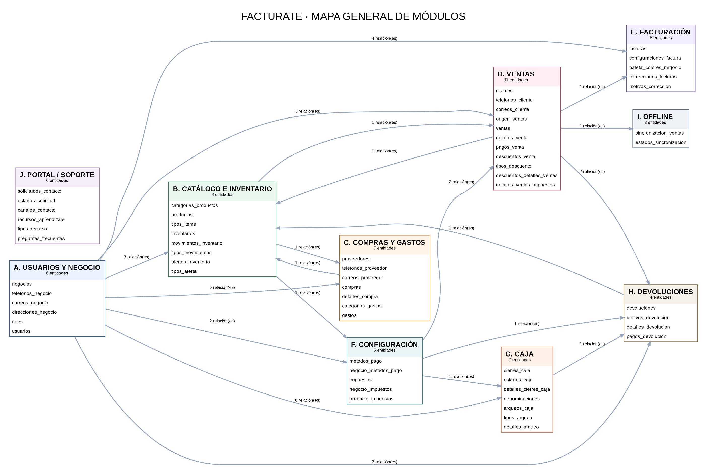
  </a>
</p>

| Código | Módulo | Alcance funcional |
|---|---|---|
| A | Usuarios y negocio | Negocios, usuarios, roles y datos de contacto. |
| B | Catálogo e inventario | Categorías, productos, inventarios, movimientos y alertas. |
| C | Compras y gastos | Proveedores, compras, detalles de compra y gastos. |
| D | Ventas | Clientes, ventas, detalles, pagos, descuentos e impuestos. |
| E | Facturación | Facturas, correcciones y configuración relacionada. |
| F | Configuración | Parámetros y catálogos configurables del negocio. |
| G | Caja | Cierres, arqueos y sus respectivos detalles. |
| H | Devoluciones | Devoluciones, detalles, motivos y pagos asociados. |
| I | Offline | Información y procesos asociados a la operación sin conexión. |
| J | Portal y soporte | Solicitudes de contacto y recursos de apoyo. |

### 2.2 Modelo ER completo

A continuación se presenta la vista integral del modelo, con las 61 entidades y los campos documentados, junto con las relaciones representadas entre los módulos.

<p align="center">
  <a href="diagramas_svg/01_Modelo_Completo.svg">
    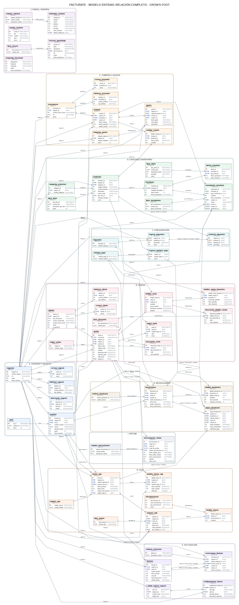
  </a>
</p>

- [Abrir modelo ER completo en SVG](diagramas_svg/01_Modelo_Completo.svg)
- [Abrir modelo ER completo en PNG](vistas_png/01_Modelo_Completo.png)
- [Consultar mapa de módulos en SVG](diagramas_svg/00_Resumen_Modulos.svg)

### 2.3 Diagramas ER por módulo

El repositorio contiene diagramas independientes para facilitar la revisión de cada área funcional.

<details>
  <summary><strong>A. Usuarios y negocio</strong></summary>
  Incluye las entidades relacionadas con la administración del negocio, usuarios, roles y datos de contacto.

  <p align="center"><a href="diagramas_svg/01_A_USUARIOS_Y_NEGOCIO.svg">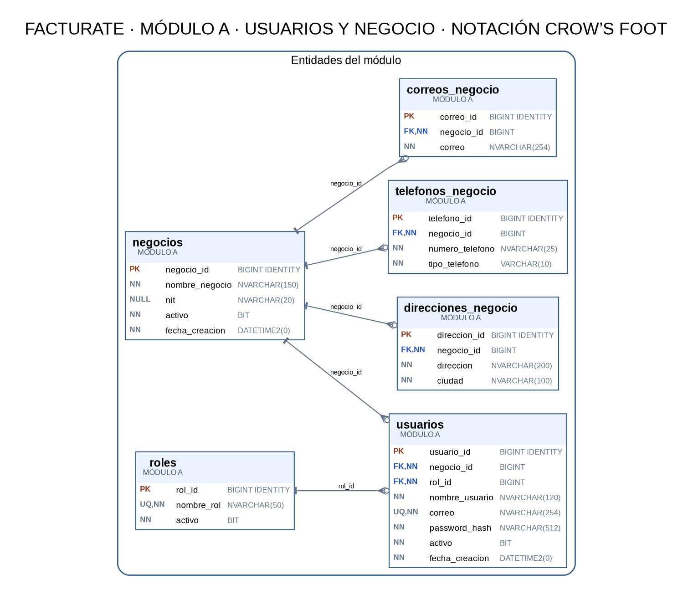</a></p>
  [Abrir SVG](diagramas_svg/01_A_USUARIOS_Y_NEGOCIO.svg) · [Abrir PNG](vistas_png/01_A_USUARIOS_Y_NEGOCIO.png)
</details>

<details>
  <summary><strong>B. Catálogo e inventario</strong></summary>
  Agrupa productos, categorías, tipos de ítem, inventarios, movimientos y alertas de inventario.

  <p align="center"><a href="diagramas_svg/02_B_CAT_LOGO_E_INVENTARIO.svg">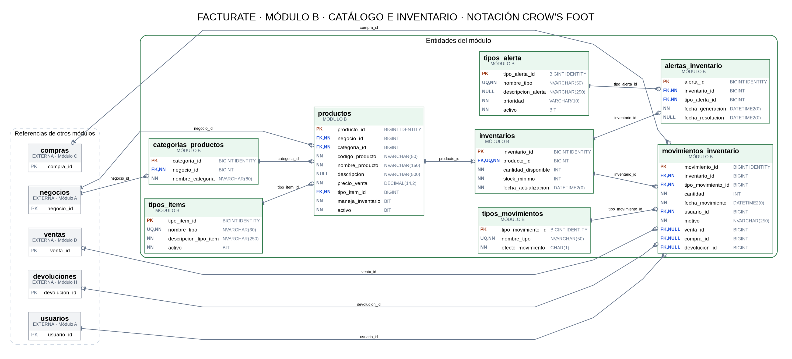</a></p>
  [Abrir SVG](diagramas_svg/02_B_CAT_LOGO_E_INVENTARIO.svg) · [Abrir PNG](vistas_png/02_B_CAT_LOGO_E_INVENTARIO.png)
</details>

<details>
  <summary><strong>C. Compras y gastos</strong></summary>
  Representa proveedores, compras, detalles de compra, categorías de gastos y gastos.

  <p align="center"><a href="diagramas_svg/03_C_COMPRAS_Y_GASTOS.svg">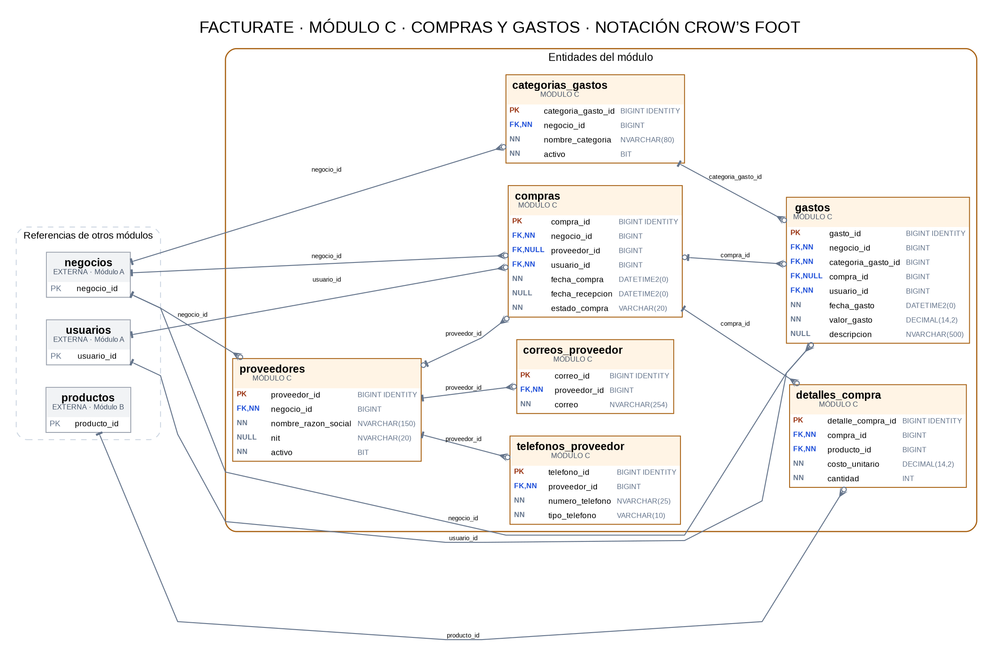</a></p>
  [Abrir SVG](diagramas_svg/03_C_COMPRAS_Y_GASTOS.svg) · [Abrir PNG](vistas_png/03_C_COMPRAS_Y_GASTOS.png)
</details>

<details>
  <summary><strong>D. Ventas</strong></summary>
  Representa clientes, ventas, detalles de venta, pagos, descuentos e impuestos asociados a las operaciones comerciales.

  <p align="center"><a href="diagramas_svg/04_D_VENTAS.svg">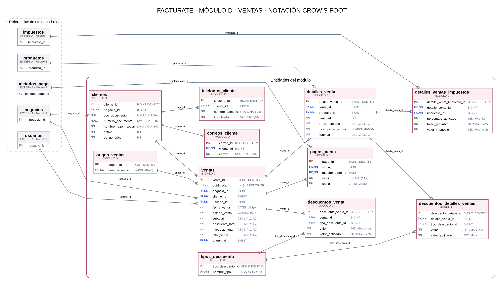</a></p>
  [Abrir SVG](diagramas_svg/04_D_VENTAS.svg) · [Abrir PNG](vistas_png/04_D_VENTAS.png)
</details>

<details>
  <summary><strong>E. Facturación</strong></summary>
  Agrupa las entidades de facturas, correcciones y configuración relacionada con la emisión de documentos.

  <p align="center"><a href="diagramas_svg/05_E_FACTURACI_N.svg">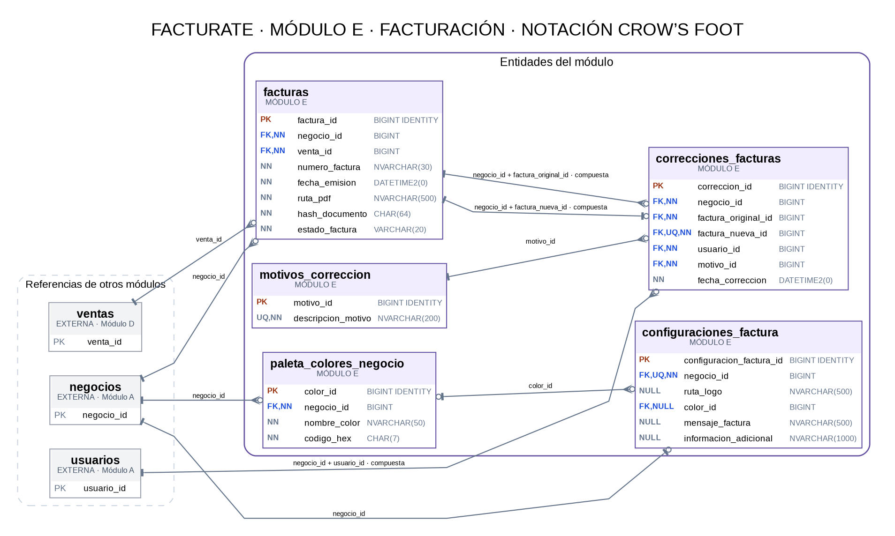</a></p>
  [Abrir SVG](diagramas_svg/05_E_FACTURACI_N.svg) · [Abrir PNG](vistas_png/05_E_FACTURACI_N.png)
</details>

<details>
  <summary><strong>F. Configuración</strong></summary>
  Contiene las entidades destinadas a parametrizar características y opciones de cada negocio.

  <p align="center"><a href="diagramas_svg/06_F_CONFIGURACI_N.svg">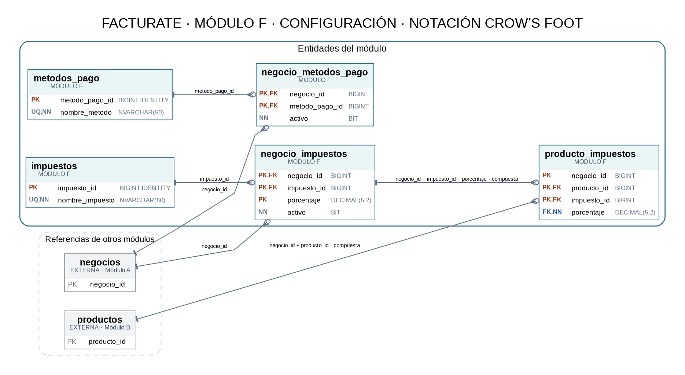</a></p>
  [Abrir SVG](diagramas_svg/06_F_CONFIGURACI_N.svg) · [Abrir PNG](vistas_png/06_F_CONFIGURACI_N.png)
</details>

<details>
  <summary><strong>G. Caja</strong></summary>
  Representa cierres de caja, arqueos y los detalles asociados a los movimientos y métodos de pago.

  <p align="center"><a href="diagramas_svg/07_G_CAJA.svg">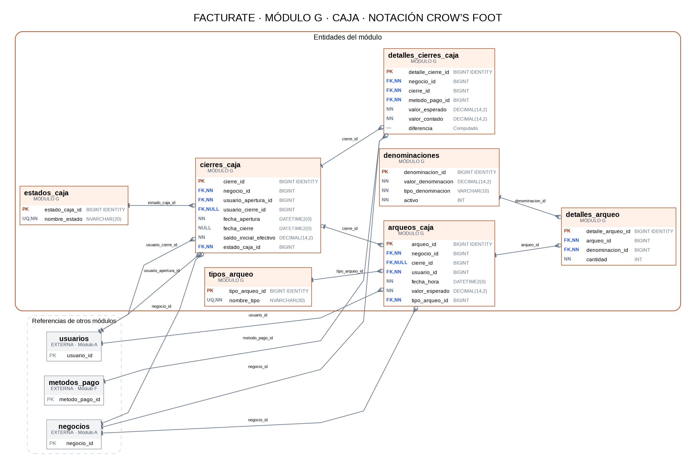</a></p>
  [Abrir SVG](diagramas_svg/07_G_CAJA.svg) · [Abrir PNG](vistas_png/07_G_CAJA.png)
</details>

<details>
  <summary><strong>H. Devoluciones</strong></summary>
  Organiza las entidades de devoluciones, motivos, detalles y pagos de devolución.

  <p align="center"><a href="diagramas_svg/08_H_DEVOLUCIONES.svg">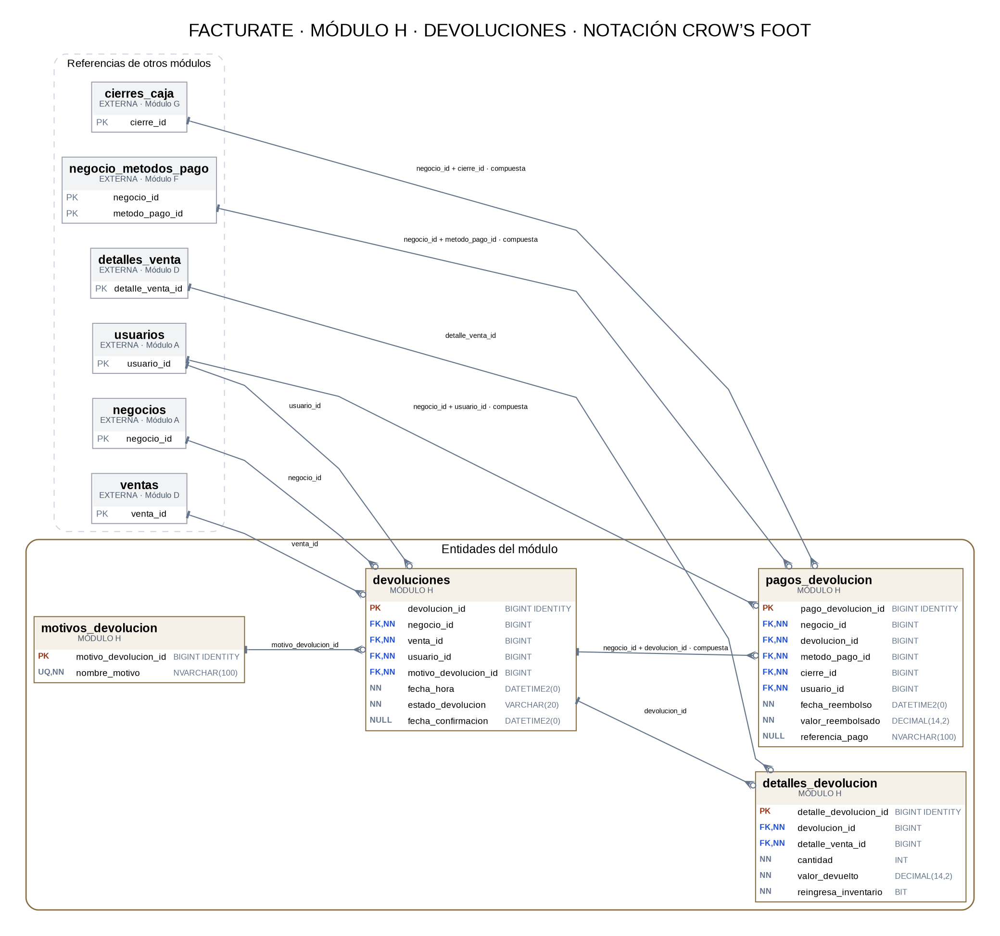</a></p>
  [Abrir SVG](diagramas_svg/08_H_DEVOLUCIONES.svg) · [Abrir PNG](vistas_png/08_H_DEVOLUCIONES.png)
</details>

<details>
  <summary><strong>I. Offline</strong></summary>
  Incluye las entidades documentadas para apoyar la operación y sincronización sin conexión.

  <p align="center"><a href="diagramas_svg/09_I_OFFLINE.svg">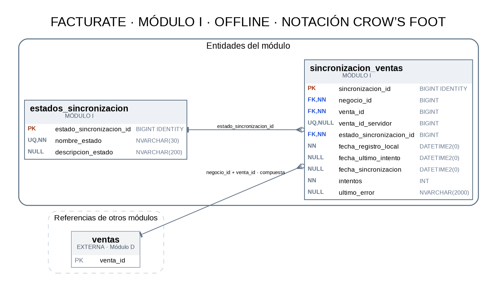</a></p>
  [Abrir SVG](diagramas_svg/09_I_OFFLINE.svg) · [Abrir PNG](vistas_png/09_I_OFFLINE.png)
</details>

<details>
  <summary><strong>J. Portal y soporte</strong></summary>
  Reúne las entidades documentadas para solicitudes de contacto y recursos de aprendizaje.

  <p align="center"><a href="diagramas_svg/10_J_PORTAL_SOPORTE.svg">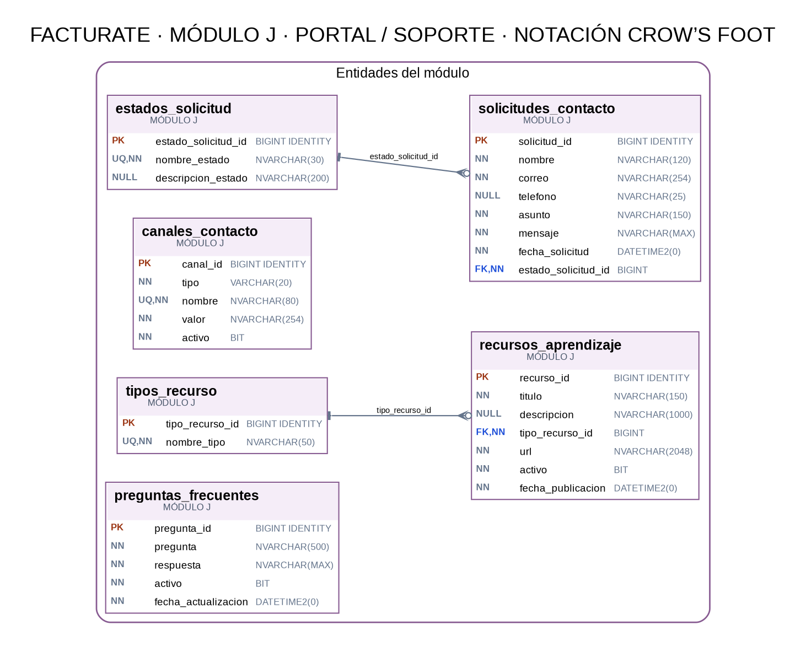</a></p>
  [Abrir SVG](diagramas_svg/10_J_PORTAL_SOPORTE.svg) · [Abrir PNG](vistas_png/10_J_PORTAL_SOPORTE.png)
</details>

### 2.4 Relaciones y notación Crow's Foot

Los diagramas utilizan notación **Crow's Foot** para representar cardinalidades y opcionalidad.

- **Barra (`|`):** representa el lado «uno».
- **Círculo + pata de cuervo:** representa cero o muchos.
- **Círculo + barra:** representa una relación opcional (cero o uno).
- **FK marcada como UNIQUE:** representa como máximo un registro relacionado en el extremo hijo.
- **Relación compuesta:** agrupa varias columnas que participan en una misma clave foránea, según la definición de la fuente.

El archivo [`relaciones_fk.csv`](relaciones_fk.csv) permite consultar el inventario de relaciones en formato tabular. Incluye la tabla padre, tabla hija, columnas de la FK, opcionalidad, unicidad y observaciones.

---

## 3. Scripts SQL — Simulación académica de cuatro tablas

La carpeta [`Scripts_SQL_4_Tablas/`](Scripts_SQL_4_Tablas/) contiene los scripts para crear y poblar una base demostrativa que permite simular el ciclo de una venta y realizar consultas de análisis.

### 3.1 Alcance de la simulación

La demostración trabaja con cuatro tablas:

- `clientes`
- `productos`
- `ventas`
- `detalles_venta`

Relaciones principales:

- `clientes` 1:N `ventas`
- `ventas` 1:N `detalles_venta`
- `productos` 1:N `detalles_venta`

El recaudo se simplifica mediante un único método de pago por venta, almacenado en `ventas`. En el modelo ER completo se contempla la entidad `pagos_venta`, que permite representar el manejo de pagos con mayor alcance.

La simulación no incluye las tablas de negocios, usuarios, categorías, tipos de ítem ni orígenes. Por ello, omite las claves foráneas hacia esas entidades.

### 3.2 Diagrama ER de la simulación

<p align="center">
  <a href="Scripts_SQL_4_Tablas/modelo_er_facturate_simulador_ventas.svg">
    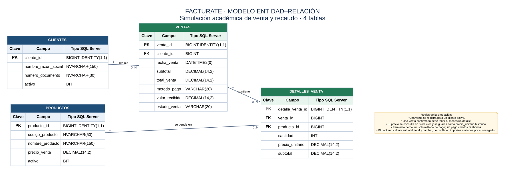
  </a>
</p>

[Abrir diagrama ER de las cuatro tablas](Scripts_SQL_4_Tablas/modelo_er_facturate_simulador_ventas.svg)

### 3.3 Organización y orden de ejecución

Los scripts están numerados para indicar el orden de preparación de la simulación:

| Archivo | Propósito |
|---|---|
| `01_Proyecto_Integrador_Facturate.sql` | Crea la base de datos `Facturate` si no existe y define las cuatro tablas, sus claves, restricciones, valores predeterminados e índices. |
| `02_Insert_Productos_Facturate.sql` | Inserta 1.000 productos de prueba. |
| `03_Insert_Clientes_Facturate.sql` | Inserta 500 clientes de prueba, incluido un único cliente genérico, y realiza validaciones. |
| `04_Insert_Ventas_Facturate.sql` | Inserta 400 cabeceras de venta inicialmente en estado `BORRADOR`, asociadas a clientes. |
| `05_Insert_Detalles_Ventas_Facturate.sql` | Inserta 1.200 detalles asociados a las ventas y productos; calcula importes y actualiza las cabeceras de venta según los detalles y las reglas del script. |
| `06_Consultas_Facturate.sql` | Contiene consultas de análisis y consultas demostrativas de INSERT y DELETE. |

**Orden recomendado:** ejecutar los scripts del 01 al 05 y, posteriormente, ejecutar las consultas del archivo 06. Los scripts de carga incorporan comprobaciones para evitar insertar nuevamente determinados lotes o duplicar registros.

### 3.4 Datos de prueba previstos

| Tabla | Registros de la carga |
|---|---:|
| `productos` | 1.000 |
| `clientes` | 500 |
| `ventas` | 400 |
| `detalles_venta` | 1.200 |
| **Total** | **3.100** |

Los registros son datos de prueba para una simulación académica. No deben interpretarse como transacciones reales de un comercio.

### 3.5 Contenido de las consultas

El archivo `06_Consultas_Facturate.sql` reúne consultas para estudiar y analizar, entre otros aspectos:

- Productos más vendidos por unidades e ingresos.
- Clientes con mayor gasto y frecuencia de compra.
- Totales de ventas, descuentos y promedios.
- Ventas agrupadas por estado, método de pago y periodo.
- Clientes sin compras confirmadas.
- Cambio entregado en ventas en efectivo.
- Productos vendidos frente al catálogo disponible.
- Productos de mayor precio.
- Operaciones demostrativas de inserción y eliminación de un producto temporal.

Las consultas de análisis distinguen las ventas confirmadas de las operaciones en borrador o anuladas. En los rankings de clientes se excluye el registro genérico cuando corresponde, para evitar agrupar compradores anónimos como si fueran un solo cliente individual.

> **Alcance CRUD:** el archivo contiene consultas SELECT, un INSERT de prueba y un DELETE controlado de un producto temporal. La actualización de las 400 cabeceras se realiza en el proceso del script de carga de detalles. Estas evidencias corresponden a scripts SQL; no implican por sí solas que exista una interfaz CRUD completa en la aplicación.

### 3.6 Consideraciones antes de ejecutar

1. Utiliza una instancia de Microsoft SQL Server accesible desde SSMS 22.
2. Revisa el contexto de conexión y confirma que puedes crear o utilizar la base de datos `Facturate`.
3. Ejecuta los scripts numerados del 01 al 05 en orden.
4. No ejecutes las cargas repetidamente sobre tablas que ya contienen los datos del lote. Los scripts incluyen validaciones y pueden cancelar la operación para evitar duplicados.
5. Ejecuta el archivo 06 después de completar la creación y carga de datos.
6. Antes de realizar pruebas destructivas o reiniciar la simulación, verifica los registros y las dependencias de claves foráneas.

**Nota sobre el nombre de la base:** el script 01 crea `Facturate` si todavía no existe y luego trabaja sobre esa base. Por tanto, si ya existe una base con ese nombre en tu instancia, no la reemplaza automáticamente. Verifica que sea el entorno correcto antes de ejecutar los scripts.

---

## 4. Estructura del repositorio

```text
Facturate_Base_De_Datos/
│
├── diagramas_svg/             # Diagramas ER del modelo completo y módulos
├── fuentes_dot/               # Fuentes editables de Graphviz
├── Scripts_SQL_4_Tablas/      # Scripts y diagrama de la simulación académica
│   ├── 01_Proyecto_Integrador_Facturate.sql
│   ├── 02_Insert_Productos_Facturate.sql
│   ├── 03_Insert_Clientes_Facturate.sql
│   ├── 04_Insert_Ventas_Facturate.sql
│   ├── 05_Insert_Detalles_Ventas_Facturate.sql
│   ├── 06_Consultas_Facturate.sql
│   └── modelo_er_facturate_simulador_ventas.svg
│
├── vistas_png/                # Versiones PNG de los diagramas
├── relaciones_fk.csv          # Inventario de relaciones FK del modelo
├── LEEME.txt                  # Convenciones y límites del modelo
├── index.html                 # Navegación de diagramas
└── README.md                  # Documentación principal
```

### Función de los recursos

| Recurso | Descripción |
|---|---|
| `diagramas_svg/` | Diagramas vectoriales del modelo ER, ampliables sin pérdida de calidad. |
| `fuentes_dot/` | Archivos fuente de Graphviz para editar y regenerar los diagramas. |
| `Scripts_SQL_4_Tablas/` | Scripts T-SQL para crear el esquema demostrativo, cargar datos, analizar ventas y consultar el diagrama de cuatro tablas. |
| `vistas_png/` | Versiones rasterizadas de los diagramas para visualización rápida y documentación. |
| `relaciones_fk.csv` | Inventario tabular de las 90 relaciones representadas en el modelo ER completo. |
| `LEEME.txt` | Fuente, notación, criterios de representación y puntos pendientes de validación. |
| `index.html` | Página de navegación de los diagramas del modelo. |

---

## 5. Visualizador del modelo

El repositorio incluye una página HTML para navegar entre los diagramas:

**[Abrir visualizador del modelo ER](https://github.com/julianz-dev/Facturate_Base_De_Datos)**

Desde allí se puede acceder al mapa de módulos, al modelo completo y a las vistas detalladas.

---

## 6. Editar y regenerar diagramas

Los archivos de `fuentes_dot/` son fuentes Graphviz editables. Después de modificar un archivo `.dot`, se puede regenerar su representación SVG o PNG con Graphviz.

Ejemplo para generar el SVG del modelo completo:

```bash
dot -Tsvg fuentes_dot/01_Modelo_Completo.dot -o diagramas_svg/01_Modelo_Completo.svg
```

Ejemplo para generar su versión PNG:

```bash
dot -Tpng fuentes_dot/01_Modelo_Completo.dot -o vistas_png/01_Modelo_Completo.png
```

Al regenerar un diagrama, conserva la correspondencia entre el archivo fuente, la versión SVG y la versión PNG para mantener actualizadas las vistas del repositorio.

---

## 7. Alcance, criterios y limitaciones

Este repositorio reúne documentación del modelo ER completo y una implementación demostrativa parcial.

1. El modelo de 61 entidades, 310 campos y 90 relaciones FK es una representación conceptual/lógica documentada.
2. La simulación SQL implementa únicamente las cuatro tablas indicadas y sus relaciones dentro del alcance académico.
3. Los diagramas del modelo completo no constituyen por sí solos un script DDL validado para crear todas las tablas en Microsoft SQL Server.
4. Las relaciones FK representadas en el modelo completo no se consideran implementadas físicamente hasta verificarlas en el DDL o en los metadatos de SQL Server.
5. La simulación de recaudo mediante un solo método de pago por venta es una simplificación; no reemplaza el diseño completo de pagos.
6. Los datos incluidos en los scripts son registros de prueba y no cotizaciones, clientes ni operaciones comerciales reales.

Antes de utilizar el modelo completo como definición física de una base de datos, se deben validar claves candidatas, restricciones, cardinalidades y reglas de negocio contra el DDL y los requisitos vigentes.

---

## 8. Fuente documental

La versión 1.0 del modelo ER se elaboró a partir del archivo **`BaseDeDatos_Facturate(5).xlsx`**, utilizado como fuente de estructura y relaciones.

El modelo conserva lo documentado en ese archivo y no incorpora automáticamente recomendaciones de auditorías o correcciones posteriores que no estén reflejadas en la fuente.

Para consultar los criterios de representación y las observaciones pendientes, revisa [`LEEME.txt`](LEEME.txt).

---

## Proyecto

**Facturate — Sistema de Recaudo Digital Simple**

Repositorio académico y técnico para documentar el modelo entidad-relación, practicar la implementación de estructuras relacionales en SQL Server y desarrollar consultas T-SQL para la simulación de ventas y recaudo.